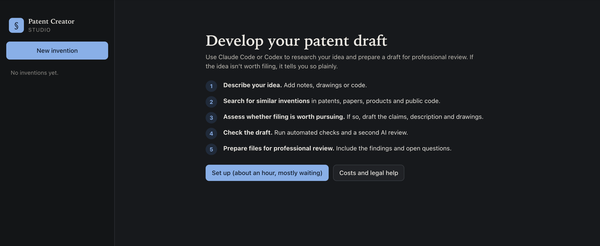
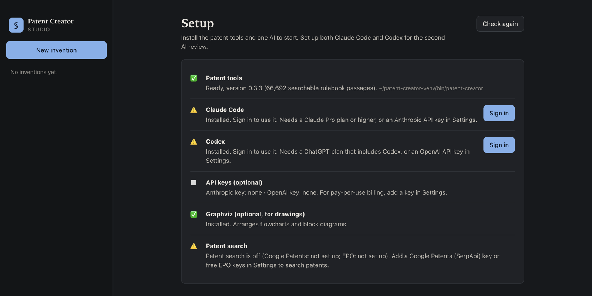

# Patent Creator Studio

**Find out if your idea is new, and walk into a patent attorney's office with a real draft in hand.**

Patent Creator Studio is a free desktop app for Mac and Windows. You describe your invention, and it walks you through it one step at a time: what's already public about it, a search for anything like it, and an honest answer on whether it's worth filing. If it is, it drafts the claims, the description and the drawings, checks its own work, and has a second AI attack the draft before it calls anything ready for review.

Everything it writes goes into a folder on your computer that you can open and read.

## Download

Get the newest version from **[Releases](../../releases)**:

- **Mac with Apple Silicon (M1 or newer):** the file ending in `-arm64-mac.zip`
- **Mac with Intel:** the other `-mac.zip`
- **Windows 10 or newer:** the `Setup` `.exe`

The app tells you when a newer version is out.

## What you need

- **An AI to do the work.** A Claude Pro plan or higher, or a ChatGPT plan that includes Codex. An Anthropic or OpenAI API key works too. With both Claude and Codex set up, the second one reviews the first one's work, and the draft can reach "Ready for professional review".
- **A free key for patent search.** Either a [SerpApi](https://serpapi.com/users/sign_up) key for Google Patents (250 searches a month) or free keys from the [European Patent Office](https://developers.epo.org). You paste them into the app's Settings.
- **About 4 GB of free disk space** and an internet connection. Setup takes 5 to 45 minutes, mostly waiting.

The app installs everything else itself: Claude Code, Codex, Python, the patent tools and the patent rulebook. You never open a terminal.

## Install

### Mac

The app is free, so it isn't signed with a paid Apple Developer certificate, and macOS asks you to approve it once.

1. Double-click the zip you downloaded, then drag **Patent Creator Studio** into **Applications**.
2. Open it. macOS says it can't verify the developer. Select **Done**.
3. Open **System Settings > Privacy & Security**, scroll to Security, and select **Open Anyway** next to Patent Creator Studio. Enter your password, then select **Open Anyway** again.

After that it opens like any other app.

### Windows

1. Run the `Setup` `.exe`.
2. Windows SmartScreen says it protected your PC, because the installer isn't signed with a paid certificate. Select **More info**, then **Run anyway**.

It installs for your account only and needs no administrator rights.

### First run

Open **Setup** and select **Install** on each line: the patent tools, then Claude Code and Codex, then sign in. Add your patent search key under **Settings**. Then select **New invention** and describe your idea.

## The steps

| # | Step | What you get |
|---|---|---|
| 0 | Your idea and its public history | What you've already made public, and the deadlines that follow from it |
| 1 | Ideas to investigate | The patentable ideas inside what you described |
| 2 | Search | Patents, papers, products and public code close to your idea |
| 3 | Is it worth filing? | A recommendation. When it says go, the second AI checks it before drafting starts. With only one AI set up, you can choose to continue on one AI's word |
| 4 | Claims | The claims, written first |
| 5 | Description and drawings | The full description and patent-style figures |
| 6 | Check and fix | Automated checks against the patent rules, then fixes |
| 7 | Package | Everything assembled for a professional's review, with Word copies |
| 8 | Second AI review | The other AI attacks the draft the way an examiner would |

When a step needs you, it asks in plain English and waits for your answer.

## What it is, and what it isn't

It tells you "no" when the evidence says no. A well-reasoned "this already exists, and here is why" saves you the filing fee, and that's the app doing its job.

It writes drafts for a registered patent attorney or agent to review. It doesn't give legal advice, and it doesn't file anything. Its goal is to make that professional's review fast and affordable. Open **Costs and legal help** in the app for fees, deadlines and free legal assistance programs.

Your AI sends what you describe to Anthropic or OpenAI, under your own account. Your keys are stored with your operating system's secure storage.

## It's a beta

It's new, and it will have rough edges. If something breaks or confuses you, [open an issue](../../issues) and say what you were doing. I read every one.

## Where it comes from

Patent Creator Studio is built on [Claude Patent Creator](https://github.com/RobThePCGuy/Claude-Patent-Creator), the open-source patent tools for Claude Code. That project's history and contributor credit live there. The app's own code is in [`studio/`](studio). MIT licensed.
